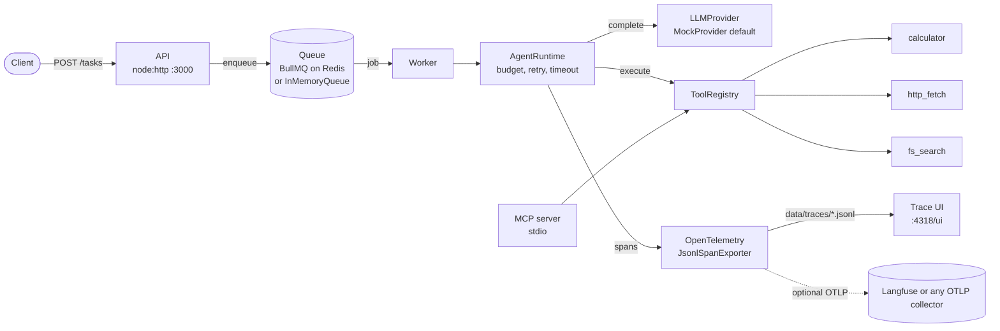

# AgentOps

[](https://github.com/iboondk/agentops/actions/workflows/ci.yml)

A small agent framework in TypeScript. It has an agent runtime with a tool registry,
an MCP server that exposes three tools, retries, timeouts and cost budgets, a Redis/BullMQ
job queue, OpenTelemetry tracing with a local trace UI, a regression eval suite that writes a
cost-per-task report, and a Docker Compose file for the full stack.

It runs fully offline by default. The default LLM is a deterministic `MockProvider`, so no API key,
network access or money is needed.

## Architecture



The API and the worker only share the queue, so they can run as separate processes. The
trace UI reads the JSONL files that the worker writes. The MCP server exposes the same tool
registry the runtime uses.

## Quick start

### Option A: Docker Compose (full stack)

Requires Docker with the Compose plugin.

```bash
cp .env.example .env        # optional; the defaults run offline
docker compose up --build   # redis, api, worker, ui
```

Then submit a task and read the result:

```bash
curl -s -X POST http://localhost:3000/tasks \
  -H 'Content-Type: application/json' \
  -d '{"input":"calculate (2+3)*4"}'
# -> {"id":"<uuid>"}   (HTTP 202)

curl -s http://localhost:3000/tasks/<uuid>
# -> {"id":"<uuid>","state":"done","result":{"status":"ok","output":"Answer: 20",...}}
```

Ports: API on `3000`, trace UI on `4318` (`/ui`). Open `http://localhost:4318/ui` after `docker compose up`.

To also export spans to Langfuse or any OTLP collector, set `OTEL_EXPORTER_OTLP_ENDPOINT`
in your local `.env`, and `LANGFUSE_PUBLIC_KEY` and `LANGFUSE_SECRET_KEY` if you use Langfuse.
Then run `docker compose up --build` as usual. The `worker` service reads `.env` and exports
every job it runs. There is no separate profile, because a second worker on the same queue
would send only some of the jobs.

Langfuse itself is not bundled. Use your own instance or account. Never commit real keys.

### Option B: Node only (no Docker, no Redis)

Requires Node.js 20 or newer (`engines` in `package.json`). Development was done on Node 24,
and the Docker image uses Node 22.

```bash
npm ci
npm test              # vitest: 57 pass, 1 skipped (the Redis test, which needs REDIS_URL)
npm run typecheck     # tsc --noEmit
npm run eval          # regression suite, writes reports/cost-per-task.{md,json}
npm run api           # API plus an in-process worker on an in-memory queue
npm run ui            # trace UI on http://localhost:4318/ui
npm run mcp           # MCP server on stdio (see mcp.json)
```

## Commands

| Command | What it does |
|---|---|
| `npm start` | Same as `npm run api`: one command to run the API with an in-process worker, offline. |
| `npm test` | Runs the vitest suite in `tests/`. |
| `npm run typecheck` | Type-checks `src/` and `tests/` with `tsc --noEmit`. |
| `npm run eval` | Runs the 10 regression cases and writes `reports/cost-per-task.md` and `.json`. |
| `npm run api` | Starts the HTTP API on `API_PORT` (default 3000). |
| `npm run worker` | Starts a queue worker. It receives jobs only when `REDIS_URL` is set (see below). |
| `npm run ui` | Starts the read-only trace UI on `UI_PORT` (default 4318). |
| `npm run mcp` | Starts the MCP server over stdio with the three tools. |
| `npm run validate:compose` | Parses `docker-compose.yml` and checks the service wiring. Does not run Docker. |

## HTTP API

| Method and path | Response |
|---|---|
| `POST /tasks` | `202 {"id"}`. Body: `{"input": string (1-4000 chars), "budget"?: {maxUsd?, maxTokens?, maxSteps?}, "model"?: "mock-small" \| "mock-large"}` |
| `GET /tasks/:id` | `200` job record (`queued`, `running`, `done` or `failed`), or `404` |
| `GET /healthz` | `200 {"ok": true}` |

Only `mock-small` and `mock-large` have prices in `src/config/pricing.ts`. Any other model
name makes the run finish with status `error`.

## Tools

| Tool | Purpose | Limits |
|---|---|---|
| `calculator` | Arithmetic: decimals, `+ - * / % ^`, parentheses, unary minus. | Own tokenizer and shunting-yard parser. No `eval`. |
| `http_fetch` | HTTP GET of an http or https URL. | 8 s timeout, 100,000-character body cap, optional `HTTP_FETCH_ALLOWLIST`. |
| `fs_search` | Case-insensitive substring search in `.md`, `.txt`, `.json`, `.ts` files. | Stays inside `TOOLS_SANDBOX_DIR` (default `./sandbox`). Entries whose realpath leaves the sandbox are skipped. |

## Configuration

All variables are optional. `.env.example` lists them. Never commit a real `.env`.

| Variable | Default | Used by |
|---|---|---|
| `REDIS_URL` | unset (in-memory queue) | api, worker |
| `API_PORT` | `3000` | api |
| `UI_PORT` | `4318` | ui |
| `UI_HOST` | `127.0.0.1` (Compose sets `0.0.0.0`) | ui |
| `TRACE_DIR` | `./data/traces` | worker, ui, eval |
| `TOOLS_SANDBOX_DIR` | `./sandbox` | tools |
| `HTTP_FETCH_ALLOWLIST` | empty (any host) | http_fetch |
| `OTEL_EXPORTER_OTLP_ENDPOINT` | unset | optional OTLP export |
| `LANGFUSE_PUBLIC_KEY`, `LANGFUSE_SECRET_KEY` | unset | optional Basic auth for OTLP |

`MockProvider` is the only LLM provider in this version. `LLM_PROVIDER` is not read yet, so the
mock is always used. `ANTHROPIC_API_KEY` and `OPENAI_API_KEY` appear in `.env.example` as
placeholders. The adapters for those providers are not implemented, so setting them has no effect.

## Testing and CI

- `.github/workflows/ci.yml` runs typecheck, tests, the eval suite and the compose structure
  check on every push and pull request. A Redis service container is attached so that the
  BullMQ test runs.
- Tests do not need Redis or Docker. The Redis-backed suite is skipped unless `REDIS_URL` is set.

## Project layout

```
src/
  core/      types, errors, retry, timeout, budget
  config/    pricing table and costOf()
  tools/     registry, calculator, http_fetch, fs_search
  llm/       provider interface, MockProvider
  agent/     AgentRuntime (the core loop)
  mcp/       MCP server (stdio)
  tracing/   OpenTelemetry setup and JSONL exporter
  queue/     TaskQueue, InMemoryQueue, BullTaskQueue, worker
  api/       HTTP API
  ui/        trace UI server and static page
  eval/      regression cases and runner
tests/       vitest suites
sandbox/     sample documents for fs_search
reports/     generated cost-per-task report
docs/        architecture decision records (ADR-*.md)
```

## Documentation

- [docs/ARCHITECTURE.md](docs/ARCHITECTURE.md): problem, components, core loop, key decisions, results and next steps.
- [docs/](docs/): architecture decision records (ADR-0001 to ADR-0005).
- [WRITEUP.md](WRITEUP.md): short write-up of the problem, design, decisions, results and next steps.
- [DEMO.md](DEMO.md): step-by-step script for recording a GIF or Loom demo.

## Known limitations

- **Compose not run end to end.** CI runs `docker compose config` and `docker compose build`,
  but `docker compose up` with a submitted task has not been run (Docker is not installed in the
  development environment).
- **Prices are illustrative.** `mock-*` prices are placeholders for the offline provider. The
  cost report labels them as illustrative. No real provider adapter is included.
- **Redis path is exercised in CI only.** The BullMQ test needs `REDIS_URL`. CI runs it
  against a Redis service container; it has not been run locally.
- **No load numbers.** No load test (for example k6) has been run, so no throughput or latency
  figures are claimed.

## License

MIT. Copyright (c) 2026 iboondk. See [LICENSE](LICENSE).
