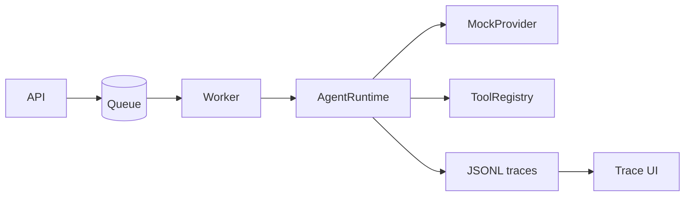

# AgentOps write-up

## Problem

Agent demos are easy to build and hard to run. A script that calls a model and a few tools
usually has no retries, timeouts, cost limits, job queue or run record. Its tests also depend
on a paid, nondeterministic API. AgentOps treats those concerns as core features and runs
offline by default.

## Architecture

The API enqueues a task. A worker takes the job and runs the agent runtime, which loops over
an LLM provider and a tool registry, and writes a span for each step.

The runtime enforces a step limit, a cost budget, per-call timeouts and retries for retryable
errors. Tools are zod schemas, and one registry serves both the runtime and an MCP server.
Docker Compose runs Redis, the API, the worker and the trace UI.

## Key decisions

- **Offline mock provider by default** (ADR-0001). Tests and evals are deterministic and free.
  The cost is that the mock does not show real model behaviour.
- **Queue interface with two adapters** (ADR-0002). BullMQ on Redis when `REDIS_URL` is set,
  otherwise an in-memory queue, so the API runs without Redis.
- **OpenTelemetry with a local JSONL exporter** (ADR-0003). Tracing works with no collector.
- **Zod schemas shared by agent and MCP** (ADR-0004). One definition serves validation,
  the model and external clients.
- **node:http and a static UI** (ADR-0005). No framework and no build step.

## Results

Measured locally on Node 24:

- `npm run typecheck` passes.
- `npm test`: 57 tests pass and 1 is skipped (the Redis suite, which needs `REDIS_URL`).
- `npm run eval`: 10 of 10 regression cases pass.
- `npm run validate:compose` confirms the Compose file parses and has the expected wiring.
- CI (`.github/workflows/ci.yml`) is configured to run on Node 22 and 24: typecheck, tests including the BullMQ suite against a Redis
  service container, the eval suite, `docker compose config` and `docker compose build`.

Not measured: `docker compose up` end to end, real provider latency and cost, and load. This write-up claims no benchmark numbers.
Cost figures use illustrative prices for the mock provider.

## Next steps

1. Add a real provider adapter behind `LLMProvider`, priced from the provider's pricing page.
2. Add a Compose smoke test that submits a task and polls until it is `done`.
3. Add API authentication, rate limits and durable job results, since in-memory jobs are lost
   on restart.
4. Put an allowlist policy in front of the MCP server, which exposes HTTP fetch and sandbox search.
5. Run `docker compose up` in CI, not only `config` and `build`.
